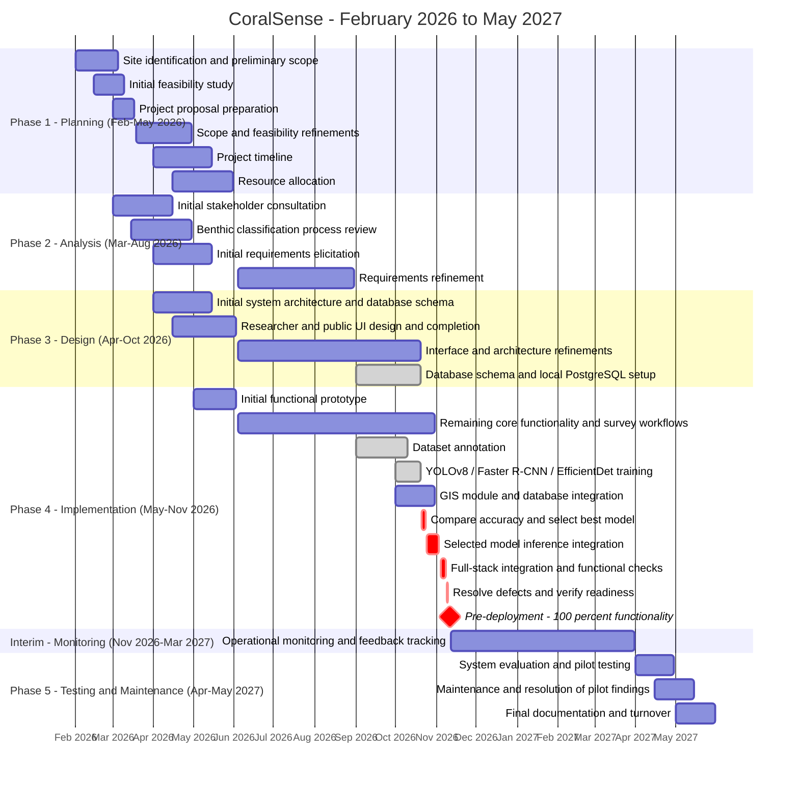

# CoralSense Capstone Project Progress Report

**Report date:** October 20, 2026  
**Title proposal defense:** March 18, 2026  
**Outline defense:** June 3, 2026 - 100% UI and 30% functionality completed.  
**Pre-deployment:** November 11, 2026  
**Pre-deployment target:** 100% of the agreed system functionality implemented, integrated, and verified.  
**Phase 5:** April-May 2027

## Introduction

CoralSense is a coral reef monitoring application that helps researchers manage underwater survey photographs, classify benthic sampling points, and assess Hard Coral Cover (HCC). Its features include survey management, dashboards, geographic visualization, analysis, and data exports. The project evaluates YOLOv8, Faster R-CNN, and EfficientDet and will integrate the model with the highest evaluation accuracy into the application.

### Gantt Chart

The revised schedule aligns early scope definition and feasibility work with March 2026 and places initial UI completion and prototype development before June 3, 2026. Subsequent work covers refinement and completion of the remaining functionality. The next milestone shown is **pre-deployment on November 11, 2026, with 100% overall functionality**. **Phase 5 remains scheduled for April-May 2027**, covering formal system evaluation, pilot testing, maintenance, final documentation, and turnover.

The dates below form the proposed revised schedule. Task windows are planning allocations rather than a reconstruction of actual start and completion dates. Completed markers reflect the team's current progress update; they do not establish that all application features are already complete.

#### Revised Timeline



#### Schedule Summary

| Phase / milestone | Revised period | Main deliverables |
|---|---|---|
| Phase 1: Planning | February-May 2026 | Initial scope, feasibility assessment, and project proposal preparation before March 18; subsequent refinements, timeline, and resource allocation |
| Phase 2: Analysis | March-August 2026 | Initial consultation, classification process review, and requirements supporting initial UI and prototype development; subsequent requirements refinement |
| Phase 3: Design | April-October 20, 2026 | Initial architecture/schema and complete UI before June 3; subsequent design refinements and local PostgreSQL preparation |
| Phase 4: Implementation | May-November 10, 2026 | Initial functional prototype, remaining core workflows, GIS/database integration, model selection/integration, and functional verification |
| Pre-deployment milestone | **November 11, 2026** | **100% of agreed functionality implemented, integrated, and verified** |
| Interim monitoring | November 12, 2026-March 31, 2027 | Operational observations and feedback records for the formal evaluation period |
| Phase 5: Testing and Maintenance | **April-May 2027** | Formal system evaluation, pilot testing, maintenance, final documentation, and turnover |

#### Current Progress Reflected in the Chart

- **Initial UI and prototype:** 100% UI and 30% functionality completed by June 3, 2026.
- **Dataset annotation:** completed.
- **Model training:** completed for YOLOv8, Faster R-CNN, and EfficientDet. Evaluation results will determine which model is integrated into CoralSense.
- **Database preparation:** PostgreSQL is running locally for deployment preparation. Local operation is separate from deployment to a hosted environment.
- **Upcoming priority:** complete model selection, inference integration, remaining application functionality, and pre-deployment verification by November 10, 2026.

#### Scheduling Notes

1. Initial scope, feasibility assessment, and proposal preparation finish before March 18. Planning continues through refinements, scheduling, and resource allocation. Phases overlap to support 100% UI and 30% functionality by June 3; subsequent UI work represents refinements. The 30% figure is a historical checkpoint, not the current completion percentage.
2. Functional testing and defect resolution occur before November 11. April-May 2027 is reserved for formal pilot evaluation and maintenance, rather than the first verification that the system works.
3. The interim monitoring window is a proposed bridge between pre-deployment and Phase 5, not an additional numbered development phase.
4. The 100% target refers to completion of agreed application functions, not 100% prediction accuracy. Model accuracy is evaluated separately using comparable evaluation data and metrics. No accuracy scores or winning model are stated until results are available.
5. The milestone requires an acceptance checklist covering the agreed authentication, survey upload, image-analysis, HCC computation, mapping, dashboard, analysis, and export/report workflows. Training and local database preparation alone do not establish end-to-end functionality.

## Project Status

### Overview of the Project's Current Stage

As of October 20, 2026, CoralSense is in the implementation and integration stage. The researcher and public interfaces have been established, and development is focused on completing the remaining workflows, connecting the selected image-analysis model, and verifying the application before pre-deployment on November 11, 2026. The target for that milestone is 100% of the agreed system functionality, rather than 100% model prediction accuracy.

Dataset annotation and training with YOLOv8, Faster R-CNN, and EfficientDet have been completed. The next model-related activity is to compare their evaluation accuracy and select the best-performing model for integration. PostgreSQL is running locally for deployment preparation; hosted deployment and end-to-end database integration checks remain separate activities.

### Accomplishments and Revisions Following the Last Consultation

The latest consultation with the expert/adviser clarified the sampling structure and revised the interpretation of survey results. These decisions guide the current implementation and the remaining acceptance checks.

#### Survey Structure: Three or More Transects

Each completed survey must contain **at least three transects**, with additional transects allowed. Survey photographs are grouped under their respective transects so that each transect serves as a sampling replicate. Image-level HCC is averaged within each transect, and the survey-level HCC is the mean of the transect means. Standard error is calculated across those transect means.

The existing data structure supports a survey containing multiple transects and allows researchers to add one transect per upload submission. A survey can therefore be built incrementally. Verification of the minimum of three transects before treating a survey as complete remains part of the readiness checklist; the current upload workflow does not enforce that minimum.

#### Revised Habitat Condition Reporting: Categories A, B, C, and D

The former three-class scheme, which described coral coverage as high, moderate, or low, has been replaced by four HCC categories. The revised scheme uses the following ranges and the descriptions maintained in `accounts/models.py`:

| Category | Hard Coral Cover range | Description |
|---|---|---|
| Category A | more than 44% | Reef coral cover is more than double the Philippine national average — comparable to or exceeding Tubbataha Reefs, one of the country's healthiest reef systems. |
| Category B | more than 33% up to 44% | Reef coral cover exceeds both the national average and the Tubbataha benchmark. |
| Category C | more than 22% up to 33% | Reef coral cover is above the national average, though below the Tubbataha benchmark. |
| Category D | 0-22% | Reef coral cover is at or below the national average. This reef may still provide meaningful ecosystem services and habitat. |

HCC counts **Hard Coral points only** in the numerator, divided by all sampled points. Soft Coral and the other benthic classes remain part of the composition results but are excluded from the HCC numerator. The survey's category is assigned from its mean HCC across transects. These categories describe coral cover and should not be presented as a complete measure of overall habitat health.

The canonical classification and survey-level aggregation functions are implemented in `accounts/models.py`. Dashboards, survey views, and analysis use these functions for headline site results. Consistency checks across previews, monthly summaries, and generated reports are still required because some consumers use different aggregation paths.

### Challenges Encountered and Responses

**Representing multiple sampling replicates within one survey.** The revised survey requirement calls for three or more transects per completed survey. To support this structure, the data model groups photographs by transect within a survey, and the upload workflow allows researchers to append transects incrementally. The remaining verification is to ensure that a survey contains at least three transects before it is treated as complete, while preserving the ability to save ongoing uploads.

**Replacing the previous three-class interpretation.** Revising the former high, moderate, and low coverage scheme required consistent category boundaries and descriptions. The canonical HCC classifier now provides Categories A, B, C, and D with defined ranges and shared wording. All displays and exports still need to be checked for consistent labels, descriptions, and classification at the category boundaries.

**Keeping survey statistics consistent.** Different aggregation methods can produce different coverage values for the same survey. The canonical site calculation addresses this by averaging image HCC within each transect, then averaging the transect means and calculating standard error across them. Remaining work involves reconciling previews, summaries, and reports that pool points or average cached image values differently.

**Moving from trained models to operational image analysis.** Completing model training is separate from connecting image analysis to the application. Training has been completed for YOLOv8, Faster R-CNN, and EfficientDet, with comparison and selection scheduled next. Evaluation results must be recorded, the best-performing model selected, and actual inference integrated into the upload workflow to replace mock analysis.

**Preparing for deployment while finishing integration.** Database preparation and application integration must be coordinated to meet the November 11 pre-deployment target. PostgreSQL is available locally, and integration and readiness checks are scheduled before that milestone. These checks must verify the deployment configuration, migrations, data persistence, and complete application workflows against the target database.

### Actual Progress Compared with the Planned Timeline

The comparison below follows the five phases of the revised Gantt chart. Overlapping dates reflect incremental development, with requirements and design refinements continuing alongside implementation.

| Phase | Revised planned dates | Progress as of October 20, 2026 |
|---|---|---|
| Phase 1: Planning | February 1-May 31, 2026 | Completed; project scope, feasibility assessment, timeline, and resource allocation have been established. |
| Phase 2: Analysis | March 1-August 31, 2026 | Completed; stakeholder needs, the benthic classification process, and system requirements have been defined and refined. |
| Phase 3: Design | April 1-October 20, 2026 | Core design is complete; the UI, system architecture, and database schema have been established, and PostgreSQL is running locally. The design-refinement window ends on the report date; final consistency checks remain. |
| Phase 4: Implementation | May 1-November 10, 2026 | In progress; core features are built, dataset annotation and three-model training are complete, and remaining work covers model selection, inference integration, workflow refinements, and functional verification. |
| Phase 5: Testing and Maintenance | April 1-May 31, 2027 | Not yet started; formal system evaluation, pilot testing, maintenance, final documentation, and turnover are scheduled for this period. Pre-deployment functional checks are scheduled separately under Phase 4. |

Phase 4 must finish before **pre-deployment on November 11, 2026**, when **100% of the agreed functionality** is required. Interim monitoring from November 12, 2026 through March 31, 2027 bridges pre-deployment and Phase 5 and is not a separate numbered phase. An exact current functionality percentage and actual completion dates for individual tasks have not been established in this report; overall readiness will be determined through integration results and acceptance checks.

## Work Completed

The work completed as of October 20, 2026 covers the application interfaces, core survey-management components, canonical HCC calculations, dataset annotation, three-model training, and local database preparation. The deliverables below distinguish implemented components from the remaining integration and acceptance activities.

### User Interfaces and Navigation

Researcher and public interfaces have been developed for viewing survey information and accessing the main workflows. These include the public landing page and dashboard, researcher dashboard, survey upload page, survey lists and details, map view, analysis results, report interface, and account-management pages. Subsequent interface work focuses on refinements and consistency with the revised survey requirements.

**Deliverables and evidence:** The public pages are maintained in [templates/](../templates/), while authenticated pages are in [accounts/templates/accounts/](../accounts/templates/accounts/). Page behavior and presentation are implemented in [static/js/](../static/js/) and [static/css/](../static/css/). A separate [frontend dashboard prototype](../examples/frontend-design/dashboard.html) demonstrates responsive layouts, Inter typography, category filtering, and site-detail dialogs using illustrative data; it is not connected to live survey records.

### Account Registration and Administration

Registration, email/password login, pending approval, and administrator approval workflows have been implemented. Administrators can manage account activation, and researchers can update profile information and photographs. Server-side notifications inform administrators of pending registrations and notify users when their accounts are approved.

**Deliverables and evidence:** Registration and authentication forms are in [accounts/forms.py](../accounts/forms.py). Account and approval handlers are in [accounts/views.py](../accounts/views.py), including `register`, `login_view`, `accept_researcher`, `manage_users`, and `account_settings`. Registration notifications are created by [accounts/signals.py](../accounts/signals.py), with navbar notification data supplied by [accounts/context_processors.py](../accounts/context_processors.py). Full permission verification remains part of pre-deployment checks.

### Survey, Transect, and Photograph Management

The survey data structure has been implemented using `ImageBatch` for a survey/site, `Transect` for its sampling replicates, and `BatchImage` for photographs and their point classifications. The upload workflow saves survey metadata, location, images, quadrat coordinates, sampling points, and benthic classifications. It creates one transect per submission and supports adding further transects to an existing survey. Survey metadata and image descriptions can also be edited.

**Deliverables and evidence:** The relationships are defined in [accounts/models.py](../accounts/models.py). The multipart upload form and client-side annotation payload are implemented in [upload_batch.html](../accounts/templates/accounts/upload_batch.html) and [upload_batch.js](../static/js/upload_batch.js), with related database writes handled by `upload_batch` in [accounts/views.py](../accounts/views.py). Multi-row creation uses `transaction.atomic()`. This completes the structural support for multiple transects; enforcement of at least three transects for a completed survey remains a separate task.

### HCC Computation and Four-Category Classification

The canonical calculation functions have been implemented for image HCC, transect means, survey HCC, and standard error across transects. The four-category classifier replaces the former three-class interpretation and uses the category ranges and descriptions presented in Project Status. The calculation counts Hard Coral only in the numerator while retaining all seven benthic classes for composition reporting.

**Deliverables and evidence:** `compute_coverage`, `compute_site_hcc`, and `classify_hcc` are maintained in [accounts/models.py](../accounts/models.py). The following excerpt shows the implemented classification boundaries:

```python
def classify_hcc(percent):
    if percent is None:
        return None
    if percent > 44:
        return 'A'
    if percent > 33:
        return 'B'
    if percent > 22:
        return 'C'
    return 'D'
```

The survey calculation averages image HCC within each transect and then averages the transect means. This provides the canonical method for survey reporting; remaining checks address consumers that still aggregate values differently.

### Dashboards, Geographic Visualization, and Export Components

Dashboard and analysis components have been implemented to display survey summaries, HCC categories, benthic composition, and trends. The map view represents survey coordinates and associated coverage information. Photograph annotation rendering draws quadrat boundaries and sampling-point markers onto stored images. Dedicated analysis CSV/PDF and survey Excel export components have also been implemented.

**Deliverables and evidence:** Public dashboard data is prepared in [coral_app/views.py](../coral_app/views.py). Researcher dashboards, map data, analysis, and export endpoints are in [accounts/views.py](../accounts/views.py). Annotated images are rendered by [accounts/image_annotator.py](../accounts/image_annotator.py). The CPCE-style workbook in [accounts/excel_export.py](../accounts/excel_export.py) summarizes benthic composition across transects with means, standard deviations, and standard errors. These dedicated exports are separate from unfinished report-builder formats and still require end-to-end acceptance checks.

### Dataset Annotation and Model Training

Annotation of the coral image dataset has been completed, together with training using YOLOv8, Faster R-CNN, and EfficientDet. This establishes the model-training stage of the image-analysis workstream. Comparison of evaluation accuracy, selection of the best-performing model, and integration of actual inference into the application remain upcoming activities.

**Deliverables and evidence:** The repository contains [YOLOv8_Coral_Training.ipynb](../YOLOv8_Coral_Training.ipynb), [FasterRCNN_Coral_Training.ipynb](../FasterRCNN_Coral_Training.ipynb), [EfficientDet_Coral_Training.ipynb](../EfficientDet_Coral_Training.ipynb), and [Model_Comparison_Report.ipynb](../Model_Comparison_Report.ipynb). These files document the training and comparison procedures. This report does not yet include numerical evaluation results or a selected-model claim; the application upload analysis still uses mock results pending inference integration.

### Database Preparation and Development Documentation

PostgreSQL has been prepared and is running locally for deployment readiness. The application's survey, user, report, and notification schema is represented by the Django models and migration files. Local PostgreSQL preparation is distinct from completing the application's connection and workflow verification against the deployment database.

**Deliverables and evidence:** Schema definitions and migrations are maintained in [accounts/models.py](../accounts/models.py) and [accounts/migrations/](../accounts/migrations/). The checked-in [settings.py](../coral_app/settings.py) still uses SQLite, so it is not evidence of a completed PostgreSQL application migration. Project architecture and development guidance are documented in [knowledge.md](../knowledge.md), [AGENTS.md](../AGENTS.md), and [CLAUDE.md](../CLAUDE.md). Reusable project skills and their sample output are documented in [agent-skills-setup.md](agent-skills-setup.md).

### Verification Evidence

Development checks using the project's virtual environment pass the Django system check and report no missing model migrations. The Django test command finds zero tests, so this result does not establish automated functional coverage. The environment also emits a `requests` dependency compatibility warning. The source files and prototype above provide implementation evidence; complete workflow demonstrations and acceptance results remain necessary before declaring 100% functionality.

## Work in Progress

The remaining work focuses on completing and integrating the agreed functionality before pre-deployment on November 11, 2026. The anticipated dates below follow the revised Gantt chart. They are completion targets, not records of completed work, and remain subject to the results of integration and verification.

### Model Evaluation and Selection

The next activity is to compare the evaluation accuracy of YOLOv8, Faster R-CNN, and EfficientDet using a consistent evaluation dataset and comparable metrics. The results will be documented to support selection of the best-performing model for CoralSense. Inference speed and resource requirements will also be recorded to assess deployment suitability. No winning model or numerical accuracy is declared before the comparison is completed.

**Anticipated completion:** October 24, 2026.

### Completion of Survey Workflows and Revised Requirements

Remaining survey-workflow refinements include verifying that a completed survey contains at least three transects while allowing researchers to save and append transects during data collection. The application must distinguish an ongoing survey from one ready for final interpretation. Additional checks will confirm that survey metadata, photographs, classifications, and shared site coordinates remain consistent when records are created or edited.

The revised Categories A, B, C, and D must also appear consistently across dashboards, survey details, analysis, previews, and exports. Coverage aggregation paths that differ from the canonical mean of transect means require reconciliation. Missing classifications must be handled explicitly rather than interpreted as zero coverage.

**Anticipated completion:** October 31, 2026.

### GIS and Application Database Integration

Geographic visualization and database integration work will verify that survey locations, metadata, transects, photographs, and analysis results are stored and retrieved correctly. With PostgreSQL running locally, the next step is to configure and verify the application's database connection, apply the existing migrations to the target database, and check data persistence and related queries. The current SQLite configuration must be addressed as part of this integration rather than treated as evidence of PostgreSQL connectivity.

Map markers and displayed survey information will be checked against the stored site coordinates. Integration checks will also cover coordinate consistency across a site's transects and the data supplied to dashboards and analysis pages.

**Anticipated completion:** October 31, 2026.

### Selected-Model Inference Integration

After model selection, actual inference will be connected to the image-upload workflow to replace mock analysis. Model outputs must be mapped to the project's seven benthic class names and converted into the quadrat, point, and classification data expected by the application. The resulting classifications will feed the existing HCC calculations without changing the canonical scientific rules.

Integration will also address processing feedback, invalid or unreadable images, inference failures, and preservation of the relationship between each photograph and its analysis results. Training completion alone does not establish that this workflow is operational.

**Anticipated completion:** November 3, 2026, following model selection by October 24.

### Full-System Integration and Functional Verification

The team will verify complete workflows across authentication, account approval, survey creation, transect uploads, actual image analysis, HCC calculation, dashboards, maps, analysis, and the agreed export/report outputs. Checks will include access permissions, validation, error handling, and consistency between displayed results and exported data. Unfinished report-builder formats and the missing authentication guard on the survey-detail view must be resolved according to the agreed functional scope before those requirements are counted as complete.

Verification will use a functional acceptance checklist and recorded outcomes. The existing Django system and migration checks will continue to support this work, but the current zero-test suite does not provide automated functional coverage. Focused tests and workflow demonstrations are needed to substantiate readiness.

**Anticipated completion:** November 8, 2026.

### Defect Resolution and Pre-Deployment Readiness

Findings from integration and functional verification will be prioritized, corrected, and rechecked. Final readiness activities will confirm the deployment configuration, database connectivity, uploaded-file handling, selected-model availability, and completion of the agreed acceptance checklist. Any unresolved requirement will remain visible rather than being counted as completed functionality.

The objective is to finish corrections and readiness verification by November 10 so that the November 11 pre-deployment milestone demonstrates 100% of the agreed functionality. Formal pilot evaluation, maintenance, final documentation, and turnover remain scheduled for April-May 2027 under Phase 5.

**Anticipated completion:** November 10, 2026.  
**Pre-deployment milestone:** November 11, 2026.

## Conclusion

This project has completed its core interfaces, survey-management components, HCC calculations, mapping, and dedicated export components. Dataset annotation, training with YOLOv8, Faster R-CNN, and EfficientDet, and local PostgreSQL preparation are also complete. Adviser revisions now guide the requirement for at least three transects per completed survey and the use of Categories A-D for HCC reporting.

The project remains in implementation and integration, targeting **100% agreed functionality by pre-deployment on November 11, 2026**. Priorities are model selection by October 24, survey and GIS/database refinements by October 31, inference integration by November 3, functional verification by November 8, and defect resolution by November 10. System and migration checks pass, but end-to-end acceptance checks are still needed to confirm readiness.

After pre-deployment, monitoring and feedback will support **Phase 5 in April-May 2027**, covering formal evaluation, pilot testing, maintenance, final documentation, and turnover.
